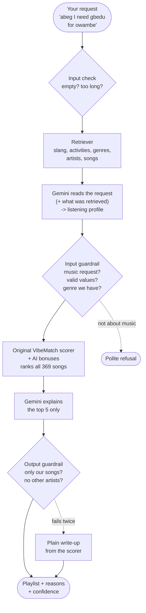

# 🎧 Vibe DJ

**Describe a vibe in plain English or Nigerian Pidgin and get a 5-song playlist of real songs, with the reason for each pick.**

> *"upbeat songs for a summer road trip"* · *"something chill to study to, no lyrics"* · *"songs like Arctic Monkeys"* ·
> *"abeg I need gbedu for owambe this saturday"* · *"I dey feel somehow today"*

Vibe DJ understands everyday requests, looks up what slang, activities, genres and artists mean,
picks songs from a catalog of **369 real songs across 32 genres** (rock, jazz, country, K-pop, house, gospel,
Afrobeats, Amapiano, Highlife and more), explains every pick, and checks its own work before showing it to you.
It's built on Google Gemini and runs as a web app or from the terminal.

**Why it matters:** most recommenders make you pick from menus, or learn slowly from your clicks. Vibe DJ lets you
just *say* what you want, the way you'd ask a friend who DJs, including in Pidgin, which most music tools don't
understand at all. It also shows its work: what it looked up, why each song made the cut, and how confident it is.

---

## Contents
1. [The base project: VibeMatch 1.0](#1-the-base-project-vibematch-10)
2. [What's new in Vibe DJ](#2-whats-new-in-vibe-dj)
3. [Architecture overview](#3-architecture-overview)
4. [Setup: run it yourself](#4-setup-run-it-yourself)
5. [Sample interactions (real outputs)](#5-sample-interactions-real-outputs)
6. [Reliability and guardrails](#6-reliability-and-guardrails)
7. [Testing summary](#7-testing-summary)
8. [Design decisions and trade-offs](#8-design-decisions-and-trade-offs)
9. [Reflection](#9-reflection)
10. [Project map](#10-project-map)

---

## 1. The base project: VibeMatch 1.0

This project extends **VibeMatch 1.0**, my **Music Recommender Simulation** from Modules 1-3 of CodePath AI110
([original repo](https://github.com/codeTMN/ai110-module3show-musicrecommendersimulation-starter)).

VibeMatch 1.0 was a rule-based, content-based recommender. You typed a taste profile **as code** (favorite genre,
mood, target energy and valence from 0 to 1, acoustic or not), and it gave every song in a catalog of **62 made-up
songs** points for how well it matched: up to 4 for energy, 3 for valence, 2 for mood, 1.5 for genre, 1 for
acoustic fit. It returned the top 5 with a list of reasons, and had 4 scoring modes and a diversity penalty.

Its own model card listed what it couldn't do: you had to type numbers like `target_energy=0.35`; exact word
matching meant "chill" and "relaxed" were different moods; an unknown genre like "k-pop" quietly gave bad results;
and the songs weren't real. **Vibe DJ fixes each of those, and keeps the original scorer as its ranking engine**
(`src/recommender.py`; the original CLI still works with `python -m src.main`). The original README and model card
are kept in [`docs/`](docs/).

## 2. What's new in Vibe DJ

| | VibeMatch 1.0 (Module 3) | Vibe DJ (this project) |
|---|---|---|
| **Input** | A Python dictionary of numbers | Plain English or Nigerian Pidgin: *"something soft for my Sunday rice"* |
| **Songs** | 62 made-up songs, 19 genres | **369 real songs, 32 genres**, pulled from Last.fm, with listen links |
| **Understanding** | Exact word matching | **RAG:** looks up 5 knowledge sources (Naija slang, activities, genres, artists, songs) before deciding |
| **AI** | None | **Gemini 3.8 Flash** reads the request, the original scorer ranks, Gemini explains the picks |
| **Agent mode** | - | Gemini **plans and uses tools**: looks things up, scores, checks the results, re-scores if they miss |
| **Safety** | - | Input and output **guardrails**, a **confidence score**, fallbacks, logging |
| **Proof it works** | 2 unit tests | **33 offline tests** + an **evaluation script** (22 requests, 4 system versions) |
| **Interface** | Terminal table | **Streamlit web app** + terminal |

The four AI features from the course are all here and wired into the same app:
**retrieval (RAG)**, an **agentic workflow**, **specialized behavior** (DJ tone and style rules, few-shot examples),
and a **reliability/testing system**.

## 3. Architecture overview

At a glance, here's what happens when you ask for a playlist (normal mode):



The full diagram, with the offline data build, agent mode, and where people and tests check the AI, is in
**[`diagrams/architecture.mmd`](diagrams/architecture.mmd)** (Mermaid source; GitHub renders it).

**The main parts, in plain words:**

- **Catalog builder** (`scripts/build_catalog.py`, run once): pulls real top tracks for hand-picked artists from
  the **Last.fm** API, has Gemini check each song really belongs to its genre and estimate its energy, mood and
  so on, then applies my manual corrections. The result is committed as `data/songs.csv`, so the app never needs Last.fm.
- **Knowledge base** (`knowledge/`): a **Naija slang glossary** (26 terms like *gbedu*, *owambe*, *Detty December*,
  *I dey feel somehow*) and an **activity guide** (18 situations like studying, gym, heartbreak), both written with AI
  help and reviewed by me, plus **genre guides** and **artist bios** built from Last.fm. All of it, plus a short card
  for every song, is turned into 693 searchable chunks with Gemini embeddings (`src/knowledge.py`).
- **The DJ** (`src/vibe_dj.py`): the pipeline in the diagram above.
- **Agent mode** (`src/agent.py`): instead of fixed steps, Gemini gets four tools (`search_knowledge`,
  `score_songs`, `finish`, `refuse`) and decides what to do. Its `finish` goes through the same output guardrail,
  and if it's rejected it gets the list of problems and fixes them. Every run's reasoning is saved to `logs/traces/`.
- **Where people and tests check the AI:** I reviewed the Afro song rows and the slang glossary; 33 unit tests check
  the guardrails; `eval.py` runs 22 test requests; [`evaluation/human_review.md`](evaluation/human_review.md) is for a
  person to rate playlists.

## 4. Setup: run it yourself

You need **Python 3.10+** (tested on 3.12) and a **Google Gemini API key**. The song catalog and search index are
already in the repo, so you do **not** need a Last.fm key.

**1. Get the code**
```bash
git clone https://github.com/codeTMN/applied-ai-system-project.git
cd applied-ai-system-project
```

**2. Make a virtual environment and install the packages** (about a minute)
```bash
python3 -m venv .venv
source .venv/bin/activate          # Windows: .venv\Scripts\activate
pip install -r requirements.txt
```

**3. Get a Gemini API key**
1. Go to **https://aistudio.google.com/apikey** and sign in with a Google account.
2. Click **Create API key** and copy it.
3. Free keys work, but Google limits them to a small number of requests per model per day (about 20 when I
   tested), and each playlist uses 2. For more than ~10 playlists a day, or to run the evaluation, link a billing
   account to the key's project in AI Studio. Each playlist costs a fraction of a cent.

**4. Put the key in a `.env` file**
```bash
cp .env.example .env               # Windows: copy .env.example .env
```
Open `.env` in any text editor and paste your key after `GEMINI_API_KEY=` (no quotes, no spaces). `.env` is in
`.gitignore`, so your key never gets uploaded. Never put a real key in `.env.example`.

**5. Check everything is ready**
```bash
python scripts/check_setup.py
```
Every line should say `OK`. Anything else comes with the exact fix (for example `-> Run: cp .env.example .env`).

**6. Run it**
```bash
streamlit run app.py                                         # web app at http://localhost:8501
python -m src.vibe_dj "upbeat songs for a summer road trip"  # terminal
python -m src.vibe_dj --agent "songs like Tems"              # agent mode (saves a reasoning trace)
python -m src.vibe_dj --trace "I dey feel somehow today"     # show every step and its timing
```

**7. Test it**
```bash
python -m pytest -q        # 33 offline tests, no API key needed, about 1 second
python eval.py             # 22 test requests on the live system, about 2.5 minutes
python eval.py --compare   # same 22 on 4 versions of the system, about 15 minutes
```

<details>
<summary><b>Using the web app</b></summary>

- Click one of the 9 example requests, or type your own in the box at the bottom.
- Each song card shows why it was picked, a **match %**, and **Spotify / YouTube / Last.fm** links.
- **🔍 How I got this playlist** shows how it read your request, what it looked up (with similarity scores), and each step's timing.
- In the sidebar (**»** at the top left): **Agent mode**, plus **experiment switches** to turn retrieval or the few-shot examples off and see the difference.
- If the key is missing, the app shows the setup steps instead of crashing.
</details>

<details>
<summary><b>Rebuilding the data (optional, needs a free Last.fm key)</b></summary>

Get a key at https://www.last.fm/api/account/create and add `LASTFM_API_KEY=` to `.env`. Then:
```bash
python scripts/build_catalog.py      # songs (cached in data/raw/, so re-runs are instant)
python scripts/build_knowledge.py    # genre guides + artist bios
```
To change the catalog, edit `data/catalog_seeds.json` (artists per genre) or `data/catalog_overrides.json`
(remove a song or fix a value), then re-run. The search index updates itself on the next run.
</details>

## 5. Sample interactions (real outputs)

These are unedited terminal outputs. All ten captured runs are in
[`assets/sample_runs.txt`](assets/sample_runs.txt). Your playlists may differ slightly, because Gemini reads
vague requests a little differently each time (see [consistency](#7-testing-summary)).

**Example 1: an everyday English request**
```
$ python -m src.vibe_dj "upbeat songs for a summer road trip"
🎧 Get ready to roll the windows down with these upbeat, feel-good tunes picked specially for your summer road trip.

1. Espresso - Sabrina Carpenter   [pop, happy, score 11.51, match 96%]
   This bright, happy pop track brings a breezy energy that sets the perfect mood for hitting the highway.
2. As It Was - Harry Styles   [pop, happy, score 11.05, match 90%]
   With its lively tempo and joyful pop feel, this track keeps the good vibes cruising along seamlessly.
3. Arcade Summer - FM-84   [synthwave, happy, score 10.82, match 78%]
   Delivering an uplifting, sunny synthwave sound, this song brings warm, nostalgic summer energy to the open road.
4. Golden - Cory Wong   [funk, happy, score 10.37, match 85%]
   A playful and groovy funk jam packed with high energy and pure cheer to keep everyone smiling.
5. Koroba - Tiwa Savage   [afrobeats, happy, score 10.36, match 86%]
   This energetic Afrobeats rhythm is vibrant, playful, and wonderfully upbeat for cruising under the sun.

Enjoy the ride and safe travels!

(confidence: 0.87 high | knowledge used: road trip / long drive, pop | explanation: gemini)
```

**Example 2: Nigerian Pidgin. Retrieval finds *gbedu* and *owambe*, and the reply matches the user's style**
```
$ python -m src.vibe_dj "abeg I need gbedu for owambe this saturday"
🎧 Oya, I hear you loud and clear! Here is pure high-energy gbedu to scatter the dance floor at your owambe this Saturday.

1. Johnny - Yemi Alade   [afrobeats, energetic, score 13.27, match 99%]
   This Afrobeats banger brings vibrant, high-energy vibes and a bright, happy mood that will instantly set the party off right.
2. Active - Asake   [afrobeats, energetic, score 12.95, match 90%]
   Super high-energy and perfectly energetic, this Afrobeats track is made to get everyone active on the dance floor.
3. UNAVAILABLE (feat. Musa Keys) - Davido   [afrobeats, energetic, score 11.66, match 91%]
   Packed with upbeat afrobeats bounce and lively energy, e go sweet all your guests as they rock the party.
4. Game Changer (Dike) - Flavour   [highlife, energetic, score 11.61, match 80%]
   Pure energetic highlife with a joyous, feel-good rhythm that screams celebration and brings that true owambe spirit.
5. People's Club of Nigeria - Oliver De Coque   [highlife, energetic, score 11.39, match 76%]
   A classic highlife jam full of warm, upbeat energy, tailor-made for spraying money and celebrating in style.

Oya dance, spray that money, and enjoy your Saturday party!

(confidence: 0.87 high | knowledge used: gbedu, owambe | explanation: gemini)
```

**Example 3: a hard constraint ("no lyrics") is respected: every pick is instrumental**
```
$ python -m src.vibe_dj "something chill to study to, no lyrics"
🎧 Here is a perfectly chilled instrumental selection designed to keep you calm, relaxed, and deeply focused on your studies.

1. Space Cadet - Philanthrope   [lofi, focused, score 14.8, match 92%]
2. just friends - potsu   [lofi, chill, score 12.15, match 79%]
3. Cello Suite No. 1 in G Major, BWV 1007: I. Prélude - Johann Sebastian Bach   [classical, focused, score 12.04, match 83%]
4. Controlla - idealism   [lofi, relaxed, score 10.84, match 74%]
5. My Favorite Things - John Coltrane   [jazz, focused, score 10.69, match 74%]
   (each pick's reason line trimmed here; full output in assets/sample_runs.txt)

(confidence: 0.80 high | knowledge used: studying / reading / homework, lofi | explanation: gemini)
```

**Example 4: agent mode. Gemini plans, calls tools, and checks its own work**
```
$ python -m src.vibe_dj --agent "songs like Tems"
🎧 If you love Tems, you'll feel right at home with these smooth, soulful alté and Afro-fusion grooves. Here is a curated set sharing her signature chilled, expressive sound.

1. Me & U - Tems   [alte, chill, score 17.51, match 90%]
2. On The Low - Burna Boy   [afro-fusion, chill, score 16.44, match 74%]
3. Culture - boJ   [alte, chill, score 16.28, match 92%]
4. Peru - Fireboy DML   [afrobeats, chill, score 16.16, match 83%]
5. Tipsy (feat. RAYE) - Odunsi (The Engine)   [alte, chill, score 14.93, match 90%]
   (reason lines trimmed here; full output in assets/sample_runs.txt)

(confidence: 0.86 high | knowledge used: Tems, Wizkid | explanation: agent)

Agent trace saved to logs/traces/20261115-151457-songs-like-tems.md
```
The saved trace shows each step: Gemini's thinking summary, the one-line reason it gives before each tool call, the
call, and the result. The traces are indexed in [`ai_interactions.md`](ai_interactions.md). One example: the agent
judged its first candidates "too loud" for *"something soft, no loud gbedu"*, re-scored with lower energy, and when
the guardrail rejected its write-up for naming an artist outside the playlist, it fixed it and resubmitted.

**Example 5: every step, with timings** (`--trace`)
```
$ python -m src.vibe_dj --trace "I dey feel somehow today"
...
TRACE
  input_check           0 ms  {"result": "ok", "chars": 24}
  retrieve            287 ms  {"rag": true, "hits": {"slang": ["I dey feel somehow / somehow (0.81)", "sapa (0.70)", ...
  parse              3184 ms  {"few_shot": true, "profile": {"is_music_request": true, "language_style": "pidgin", ...
  input_guardrail       0 ms  {"prefs": {"favorite_genre": "afro-fusion", "favorite_mood": "moody", "target_energy": 0.45, ...
  rank                  5 ms  {"mode": "mood-first", "confidence": 0.84, "picks": ["soso - Omah Lay (13.22)", ...
  output_guardrail   4012 ms  {"attempt": 1, "problems": "none"}
```

## 6. Reliability and guardrails

| What could go wrong | What Vibe DJ does | Real output |
|---|---|---|
| Empty or too-long message | Stopped before any API call | `🎧 Tell me what you're in the mood for and I'll build you a playlist.` |
| Not a music request, or a prompt-injection attempt | Gemini flags it; the DJ refuses | `🎧 I'm a music DJ, so I can only help with playlists. I cannot fulfill prompt injection or instruction alteration requests...` |
| A genre we don't have | Closest genre is used, **and the user is told** | `⚠️ We don't have bossa nova in the catalog yet, so I went with the closest sound we do have: jazz.` |
| Gemini returns out-of-range numbers or a made-up mood | Values clamped; unknown moods mapped (e.g. "confident" -> energetic) | covered by unit tests |
| Gemini's write-up invents a song, skips one, or names an artist not in the playlist | **Rejected.** Retried once with the list of problems, then replaced by a plain write-up from the scorer | covered by unit tests; seen live in agent traces |
| "No lyrics" ignored | Songs with vocals are pushed down hard when you ask for none | Example 3 above |
| Weak matches | **Confidence score** on every playlist; below 60% the user gets a warning | `(confidence: 0.87 high ...)` |
| Main model overloaded | Short timeouts, then automatic switch to a backup model (`gemini-3.6-flash`) | logged in `logs/vibe_dj.log` |
| Missing or invalid API key | Plain-language setup steps instead of a crash | `🎧 Vibe DJ needs a Gemini API key. Copy .env.example to .env and paste your key...` |
| Agent gets stuck | Max 8 turns, max 3 searches, a "turns left" reminder, then the normal pipeline answers | trace: [`ran out of steps -> pipeline fallback`](logs/traces/20261115-140430-my-guy-i-dey-feel-somehow-something-soft.md) |

Every step is logged to `logs/vibe_dj.log`, and each result carries a step-by-step trace (shown in the app's
"How I got this playlist" panel).

## 7. Testing summary

> **21 of 22 test requests passed (95%), and 79 of 80 checks.** All 11 English requests and all 5 guardrail cases
> passed; agent mode passed 22/22. **Average confidence was 0.86.** The one failure: *"worship songs for quiet time
> with God"* returned only gospel (correct), but average energy was 0.61 against a 0.60 limit, because our gospel
> catalog leans toward upbeat praise songs. **The first evaluation run scored 19/22.** It exposed a real bug: asking
> for "k-pop" or "jazz" only ever gave 2 songs of it, because of VibeMatch 1.0's "max 2 per genre" rule. Fixing it
> brought the score to 21/22. **33 offline unit tests pass.**

```
$ python eval.py --table      # comparison of the saved runs (agent row re-run after a fix)
| Variant | All cases | English | Naija | Guardrails | Checks | Avg confidence | Avg time |
|---|---|---|---|---|---|---|---|
| Full system (retrieval + few-shot) | 21/22 (95%) | 11/11 (100%) | 5/6 (83%) | 5/5 (100%) | 79/80 (99%) | 0.86 | 6.0 s |
| No retrieval | 17/22 (77%) | 10/11 (91%) | 2/6 (33%) | 5/5 (100%) | 75/80 (94%) | 0.89 | 6.8 s |
| No few-shot examples | 21/22 (95%) | 11/11 (100%) | 5/6 (83%) | 5/5 (100%) | 79/80 (99%) | 0.87 | 6.5 s |
| Agent mode | 22/22 (100%) | 11/11 (100%) | 6/6 (100%) | 5/5 (100%) | 80/80 (100%) | 0.81 | 10.1 s |
```

**What worked**
- **Retrieval is what makes the Nigerian requests work.** Without it, *"gbedu for owambe"* got Kirk Franklin
  (gospel), Sister Sledge (disco) and Kool & the Gang (funk): 2 of 5 Afro songs. With it: Davido, Asake, Oliver De
  Coque, Flavour, Yemi Alade, 5 of 5. Nigerian requests went from 2/6 to 5/6.
- **The DJ's tone rules measurably change the output:** on the same songs, 4.0 Pidgin words per reply for Pidgin
  requests vs 1.0 for a plain prompt, and none leaking into English replies ([tone test](evaluation/tone.md)).
- **Guardrails held every time:** 5/5 edge cases in every version, and 0 crashes in 110+ evaluated requests.
- **Consistency:** specific requests gave identical playlists 3 runs in a row; average overlap 0.87 ([details](evaluation/consistency.md)).

**What didn't**
- **The few-shot examples made no measurable difference** (38/38 checks with and without them). Gemini 3.8 plus the
  retrieved knowledge already reads requests correctly.
- The confidence score can't tell when a request was *misread*: without retrieval it was actually *higher* (0.89),
  because songs fit the wrong profile well.
- Vague requests ("summer road trip") vary run to run: 3 of 5 songs stayed the same.

**What I learned:** test the whole system, not just the AI parts. The worst bug the evaluation found was in my own
Module 3 rules, not in Gemini. And measure every "improvement": one I was sure about (few-shot) did nothing, and one I
almost skipped (retrieval) did the most. Full details: [`evaluation/README.md`](evaluation/README.md).

## 8. Design decisions and trade-offs

- **Keep the original scorer as the ranking engine, and don't let the LLM pick songs.** Gemini *reads* the request and
  *writes* the explanation, but the deterministic VibeMatch scorer ranks. *Trade-off:* less creative than letting
  Gemini choose, but Gemini can't invent songs, every pick has numeric reasons, and the scorer is fully unit-tested.
- **Real songs from a one-time build, not live API calls.** Last.fm's genre tags turned out to be noisy (the
  `afrobeats` tag returned Beyoncé and K-pop; `highlife` returned Rick Astley), so songs come from human-picked seed
  artists' real top tracks. *Trade-off:* the catalog is a snapshot, and energy/mood values are Gemini estimates
  (Spotify stopped offering audio features to new apps in 2024), marked `features_source=gemini-estimate`.
- **Retrieval before reading.** Slang and activity knowledge is fetched *first*, so it shapes how Gemini reads the
  request. *Trade-off:* one embedding call (about 0.3 s) on every request, even plain ones.
- **Per-source retrieval.** The best hits are taken from each source separately, so 369 song cards can't crowd out 26
  slang terms. Hits under 0.62 similarity are dropped.
- **Gemini 3.8 Flash with low thinking, and a 3.6 backup.** Low thinking was 4x faster (2.2 s vs 8.8 s per call) with
  the same quality, cutting a playlist from ~16 s to ~6 s. *Trade-off:* the newest model was sometimes overloaded, so
  the backup is a slightly older model.
- **Agent mode as an option, not the default.** It's more flexible and self-correcting, but slower (about 10 s vs 6 s)
  and less predictable, so the fixed pipeline is the default and also the agent's safety net.
- **Diversity, except when you ask.** VibeMatch's "max 2 per genre" rule stays for vague requests, but an *explicit*
  genre ("k-pop", "smooth jazz") is exempt and boosted.

## 9. Reflection

This project taught me that an AI system is mostly *everything around* the model. Gemini was good at reading
"I dey feel somehow" from day one. The work was giving it the right knowledge, limiting what it's allowed to decide,
checking what comes back, and measuring whether each change actually helped. Several of my biggest fixes came from
evidence, not ideas: a trace where the agent ran out of steps, an evaluation run that exposed my own Module 3 rule,
a test showing my favorite feature (few-shot) did nothing measurable.

**What this project says about me as an AI engineer:** I build AI features on top of things I can test, I treat the
model's output as untrusted until it's checked, and I make systems explain themselves. I also brought something
personal into it. Most music AI doesn't understand how people in Nigeria actually talk about music, so I built a
recommender that does, without making it only for Nigerians.

My full reflection (limitations, misuse, what surprised me, and how I worked with AI, including suggestions I
accepted and rejected) is in **[`model_card.md`](model_card.md)**. The agent's reasoning traces are in
[`ai_interactions.md`](ai_interactions.md).

**Video walkthrough (optional):** *add Loom link here*

## 10. Project map

```
app.py                     Streamlit web app
eval.py                    evaluation harness (22 cases, comparisons, tone/few-shot/consistency tests)
src/
  vibe_dj.py               the DJ pipeline: retrieve -> read -> guardrail -> rank -> explain -> guardrail
  agent.py                 agent mode (Gemini tool calling + saved traces)
  knowledge.py             chunking, Gemini embeddings, per-source search
  gemini_client.py         Gemini calls: timeouts, retries, backup model, logging
  recommender.py           VibeMatch 1.0 scorer (original; small additions: AI bonuses, genre exemption)
  vocab.py                 allowed moods and tags
  main.py                  VibeMatch 1.0 CLI (original)
scripts/
  build_catalog.py         Last.fm + Gemini -> data/songs.csv
  build_knowledge.py       Last.fm -> knowledge/genres.md, knowledge/artists.md
  check_setup.py           "is everything ready?" check
data/                      songs.csv (369 real songs), seeds, overrides, cached API data, search index
knowledge/                 naija_slang.md, activities.md, genres.md, artists.md
diagrams/architecture.mmd  full system diagram (Mermaid)
evaluation/                saved evaluation results (start with evaluation/README.md)
logs/traces/               agent reasoning traces (linked from ai_interactions.md)
assets/sample_runs.txt     real terminal outputs used in this README
tests/                     33 offline tests
docs/                      VibeMatch 1.0's original README and model card
model_card.md              limitations, misuse, testing surprises, AI collaboration
ai_interactions.md         agent traces + Module 3 AI log
```

**Data credits:** song lists, tags, genre wikis and artist bios come from [Last.fm](https://www.last.fm)
(user-contributed text, CC BY-SA). Audio values (energy, mood, ...) are estimates by Gemini, not measurements.
